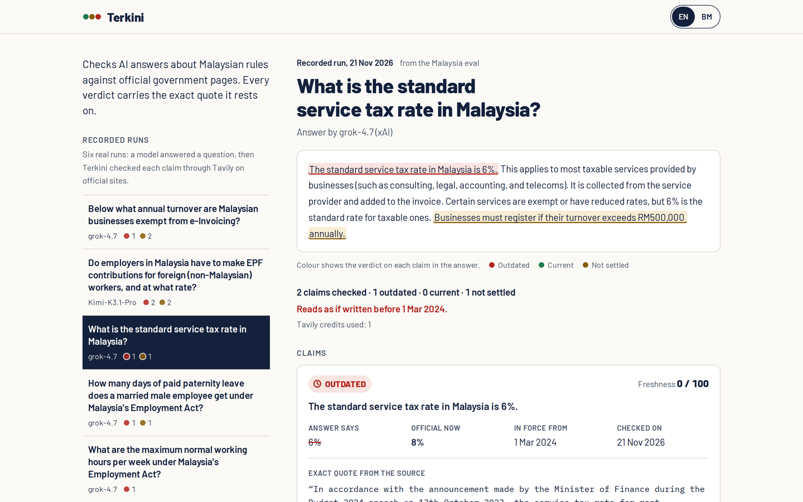
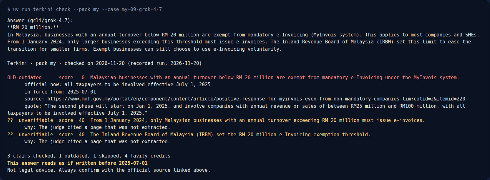
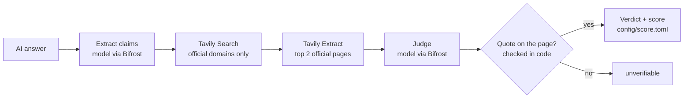

<p align="center"></p>

<h1 align="center">Terkini</h1>

<p align="center"><a href="https://github.com/aimanmalib/terkini/actions/workflows/ci.yml"></a> <a href="LICENSE"></a>   </p>

<p align="center"><b>Is this AI answer still true where you live?</b> · <i>Adakah jawapan AI ini masih betul di tempat anda?</i><br>
<a href="#try-it-in-three-steps">try it</a> · <a href="https://aimanmalib.github.io/terkini/">replay page</a> · <a href="#one-command-demo-docker">demo</a> · <a href="https://aimanmalib.github.io/terkini/deck.pdf">slides</a> · <a href="docs/EVAL.md">eval</a> · <a href="CHANGELOG.md">changelog</a> · <a href="README.ms.md">Bahasa Melayu</a> · Built in Malaysia by <a href="https://aimanmalib.com">Aiman Malib</a></p>

<p align="center"></p>

Terkini takes an AI answer about a Malaysian rule, such as the minimum wage, an EPF contribution rate, an electricity
tariff or the turnover limit for e-invoicing. It pulls out each factual claim, checks it against official government pages through
Tavily Search and Extract, and gives every claim a freshness score with the exact quote from the official source. All model
calls go through a Bifrost gateway.

**Eval, 21 Nov 2026:** 28 of 68 answers from 3 models stated a Malaysian rule that differs from the current official value; Terkini flagged 10 of them against official pages (precision 59%, recall 36%). Details and failures: [`docs/EVAL.md`](docs/EVAL.md).

- Replay page: <https://aimanmalib.github.io/terkini/> (six recorded runs, English and Bahasa Melayu, no key)
- Slides (PDF): <https://aimanmalib.github.io/terkini/deck.pdf>
- Video (72 s, captions burned in, `.srt` beside it): <https://aimanmalib.github.io/terkini/media/terkini-demo.mp4>

> **Not legal advice.** Terkini compares an answer with what official pages say on the day it runs. It can miss a page,
> misread one, or check a page that is itself out of date. Confirm anything important with the agency.

Built during the Global AI Hackathon (extended window, 21 Nov 2026), Tavily track, problem statement PS06 (stale-answer
detector). First commit: `397bbc2`.

## Status

Not finished. What works and what does not, as of today:

- **Works:** the full check from the command line. Claim extraction and judging through Bifrost, Tavily Search and
  Extract on official domains only, the exact-quote check in code, and the freshness score. Three live runs from
  20 Nov 2026 are recorded and replay offline. The eval over the 23 Malaysian questions has run on 68 answers
  from three models ([`docs/EVAL.md`](docs/EVAL.md)).
- **Weak spots:** recall is 36%. Most missed answers end `unverifiable` because the official pages that
  search returns do not settle the claim.
- **Also works:** the replay page with six recorded runs in English and Malay, `POST /api/check`, which
  returns the same report as JSON for a team that checks answers before users see them, and a one-command
  demo with Docker.
- **Not done:** the India pack (dropped to stay within the Tavily credit budget, D-017).

## Try it in three steps

You need [uv](https://docs.astral.sh/uv/). No API key is needed for replay mode.

```bash
git clone https://github.com/aimanmalib/terkini && cd terkini
uv run terkini check --list                               # the recorded runs
uv run terkini check --pack my --case my-12-kimi-k3-1-pro # replay one of them, offline
uv run terkini serve                                      # the replay page at http://127.0.0.1:8710
```

The second command prints the report below. It is a real answer from Kimi K3.1 Pro, checked live on 20 Nov 2026
and replayed from `tests/fixtures/runs/`:

```text
Terkini · pack my · checked on 2026-11-20 (recorded run, 2026-11-20)

OLD outdated      score   0  For non-Malaysian workers registered on or after 1 August 1998, the employer's EPF
                             contribution was a flat RM5 per month.
      official now: Employers are only required to register and contribute for their non-Malaysian citizen
                    employees starting 1 October 2025
      in force from: 2025-10-01
      source: https://www.kwsp.gov.my/en/employer/responsibilities/non-malaysian-citizen-employees  (search snippet)
...
4 claims checked, 2 outdated, 3 skipped, 8 Tavily credits
This answer reads as if written before 2025-10-01
```

Read this one with [`docs/EVAL.md`](docs/EVAL.md). In the eval, Kimi's answer to the same question was labelled current
and Terkini still flagged it: one of the seven false positives. Here, the first claim is history ("was a flat RM5"),
and the checker marks it outdated.

The other two recordings: DeepSeek V4.1 Flash on the minimum wage (one claim current at RM1,700 from 1 February 2025,
4 credits) and Grok 4.7 on the e-invoicing exemption (one claim outdated, 4 credits).



The verdict on this one is right, but its evidence is old: a 2023 Ministry of Finance statement. The current rule, in the
answer key from hasil.gov.my, exempts businesses with turnover under RM3,000,000.

### One-command demo (Docker)

If you have Docker but not uv, this starts the replay page and the API from the clone. No key is needed.

```bash
demo/run.sh          # prints a recorded report, the page URL and a curl line for the API
demo/run.sh stop     # removes the container
```

It uses the official uv image, pinned by digest, with the folder mounted read-only. It picks the first free port from
8710 and removes the container if anything fails.

### Live mode

Live mode checks any answer you paste. It needs your own Tavily key and a running Bifrost gateway.

```bash
cp .env.example .env            # fill in TAVILY_API_KEY, BIFROST_URL, PROVIDER_BASE_URL, PROVIDER_API_KEY, BIFROST_SETUP_TOKEN
docker compose up -d            # the official Bifrost image, pinned by digest, on 127.0.0.1 only
uv run scripts/bifrost-bootstrap.py   # adds the provider and a virtual key with a budget, saved to .env.bifrost
uv run terkini check --pack my "The minimum wage in Malaysia is RM1,500 a month."
docker compose down -v          # stop and remove everything
```

### HTTP API

`terkini serve` also answers `POST /api/check`, with the same mode rule as the CLI. Without `TAVILY_API_KEY` it
replays recorded runs; with your keys in `.env` it checks live and spends your credits, so it listens on 127.0.0.1.

```bash
curl -s -X POST http://127.0.0.1:8710/api/check -H 'content-type: application/json' \
  -d '{"case": "my-12-kimi-k3-1-pro"}'          # or {"answer": "...", "pack": "my"}
```

The reply is the report as JSON: `mode`, `pack`, `checked_on`, and one entry per claim with its verdict, the official
quote, the source URL and the score. Errors: 400 unknown pack, 404 no recording (replay mode), 413 answer too long
(limit in [`config/api.toml`](config/api.toml)), 422 empty request, 503 gateway not set up (live mode).

Any OpenAI-compatible provider works upstream of Bifrost. The model ids in [`config/models.toml`](config/models.toml)
are the ones this project was tested with; change them to ids your provider serves.

## Evaluation

23 questions about Malaysian rules, an answer key read from official pages before any model answer was seen, and 68
answers from three models, checked on 21 Nov 2026. Numbers from [`eval/my/results.json`](eval/my/results.json); method,
dropped questions and failures in [`docs/EVAL.md`](docs/EVAL.md).

| Measure | Value |
|---|---|
| Answers that differ from the current official value | 28 of 68 |
| Answers Terkini flagged | 17 |
| Flagged and really stale | 10 |
| Precision / recall | 59% / 36% |
| Claims checked | 214 (20 outdated, 59 current, 135 unverifiable) |
| Verdicts backed by an exact official quote | 79 |
| Tavily credits | 276, about 1.3 per checked claim |

| Model | Answers | Differ from the key | Flagged | Flagged and stale |
|---|---|---|---|---|
| `gcli/grok-4.7` | 23 | 20 | 9 | 9 |
| `rv/deepseek-ai/DeepSeek-V4.1-Flash-1017` | 23 | 6 | 4 | 1 |
| `rv/moonshotai/Kimi-K3.1-Pro` | 22 | 2 | 4 | 0 |

Most misses end `unverifiable`: the official pages returned for a claim did not settle it, so no verdict was given.

## How it works



1. **Extract.** A model reads the answer and returns each factual claim with a category from the country pack, as JSON.
   Duplicate claims are merged before any search.
2. **Search.** Each claim is searched with Tavily on the pack's official domains only. Volatile categories ask for fresh
   results. If nothing official comes back, the search is retried once at `advanced` depth.
3. **Extract pages.** The top two official pages are read with Tavily Extract, PDFs included. If every page refuses
   extraction, the judge reads the official search snippets instead, and the claim says "search snippet".
4. **Judge.** A model from a different vendor than the answering models compares the claim with the page text and
   returns a verdict (`current`, `outdated` or `unverifiable`), a quote, the official value and an effective date.
5. **Check in code.** The verdict stands only if the quote appears word for word on the page the judge named. A date
   counts only if it is written inside that quote. Otherwise the claim is `unverifiable`.
6. **Score.** Plain arithmetic with fixed weights from [`config/score.toml`](config/score.toml): the verdict, whether
   the source is a government domain, whether the quote was found, and the page date. The report also says which date
   the answer reads as if it were written before. With a government quote, a current claim scores up to 100, an
   outdated one scores 0, and an unverifiable one at most 50.

What a country pack holds, in [`packs/my.toml`](packs/my.toml): 12 official domains (each labelled government or
utility), the claim categories, which categories change often, and the question file for the evaluation. Code holds
no domains. A new country is a new pack file.

## Where we use Tavily

All calls are plain `httpx` requests to the Tavily REST API ([`src/terkini/tavily.py`](src/terkini/tavily.py)); the
parameter values live in [`config/verify.toml`](config/verify.toml).

| What | Where |
|---|---|
| Search on official domains only: `include_domains` from the pack, `include_domains_mode = "restrict"` | [`src/terkini/verify.py#L107-L113`](src/terkini/verify.py#L107-L113) |
| `max_age_hours = 0` for volatile categories, so the answer comes from live pages | [`src/terkini/verify.py#L114-L115`](src/terkini/verify.py#L114-L115) |
| HTTP `434` (live capacity full): one retry without `max_age_hours`, marked "Tavily cached copy" | [`src/terkini/verify.py#L120-L127`](src/terkini/verify.py#L120-L127) |
| `basic` depth first, one `advanced` retry when nothing official comes back | [`src/terkini/verify.py#L152-L157`](src/terkini/verify.py#L152-L157) |
| Extract on the top two official pages, PDFs included | [`src/terkini/verify.py#L136-L143`](src/terkini/verify.py#L136-L143) |
| `include_usage` on every call; credits counted from each response | [`src/terkini/tavily.py#L56-L71`](src/terkini/tavily.py#L56-L71) |
| Credit guard: a call is refused before it is sent if it would cross the run or daily limit | [`src/terkini/credits.py`](src/terkini/credits.py), [`config/budget.toml`](config/budget.toml) |

## Where we use Bifrost

Every model call goes through a Bifrost gateway: the official, unmodified image, pinned by digest in
[`docker-compose.yml`](docker-compose.yml).

| What | Where |
|---|---|
| One virtual key for the app, sent as `x-bf-vk` | [`src/terkini/gateway.py#L113-L122`](src/terkini/gateway.py#L113-L122) |
| Fallback models sent as Bifrost `fallbacks` on every request | [`src/terkini/gateway.py#L124-L128`](src/terkini/gateway.py#L124-L128), [`config/models.toml`](config/models.toml) |
| Daily budget and rate limits on the virtual key, created through the governance API | [`scripts/bifrost-bootstrap.py#L78-L94`](scripts/bifrost-bootstrap.py#L78-L94), [`config/bifrost.toml`](config/bifrost.toml) |
| Upstream timeout, so a stalled model call moves to the next fallback | [`config/bifrost.toml`](config/bifrost.toml) |
| Three answering models from three vendors, and a judge from a fourth vendor | [`config/models.toml`](config/models.toml) |

## How AI is used

- **Claim extraction:** `rv/GLM-5.3` (Zhipu AI) splits an answer into claims, as JSON, temperature 0.
- **Judging:** `rv/GLM-5.3` compares each claim with the official text. Its quote and date are then checked in code.
- **Answers being checked:** `gcli/grok-4.7` (xAI), `rv/moonshotai/Kimi-K3.1-Pro` (Moonshot AI) and
  `rv/deepseek-ai/DeepSeek-V4.1-Flash-1017` (DeepSeek). The judge comes from a different vendor, so no model grades
  its own answer.
- **Not AI:** the domain filter, the quote check, the date check and the score are plain code.

Prompts are in [`config/prompts.toml`](config/prompts.toml). Model ids are in [`config/models.toml`](config/models.toml).

### AI disclosure

- The code and the documentation in this repository were written with Claude Code (Claude Opus).
- The eval labels in `eval/my/labels.yaml` were written with Claude Code, by reading each model answer against the key.
- The product calls the language models listed above through a Bifrost gateway.
- The narration in the demo video is an AI clone of my own voice (ElevenLabs). The end card says so. Source:
  [`demo/video/`](demo/video/).

## Limitations

- **Only what the index holds.** Terkini sees the official pages Tavily returns for a query. A page that is not
  indexed, or that blocks extraction, cannot decide a verdict.
- **Official pages go stale too.** A ministry page can lag behind a new order. Terkini reports the page it read and
  its date; it does not know about rules that no official page states yet.
- **Many claims end up `unverifiable`.** Often the official pages Tavily returns for a claim do not settle it, so the
  claim is set aside. That is the intended failure: no quote, no verdict. See [`docs/EVAL.md`](docs/EVAL.md).
- **The answer key is ours.** The evaluation key in `eval/my/key.yaml` was written by reading official pages before
  any model answer was seen. It can still contain mistakes.
- **Not legal advice.** See the note at the top.

## Repository layout

| Path | What |
|---|---|
| `src/terkini/` | The checker: claims, Tavily client, verifier, judge, quote check, score, cache, replay, CLI, HTTP API |
| `config/` | Every tunable value: models, gateway, search parameters, score weights, credit limits, prompts |
| `packs/` | Country packs (domains, categories) |
| `eval/my/` | 23 Malaysian questions, their answer key, model answers, labels, one run per answer, `results.json` |
| `tests/` | Offline tests; `tests/fixtures/` holds recorded runs with no keys |
| `scripts/` | Gateway setup, recording live runs, checking the answer key, eval tables, building the page data |
| `demo/` | `run.sh`: the replay page and the API in Docker, from a clean clone |
| `docs/` | The replay page and slides (GitHub Pages), decisions, eval report |
| `deck/` | Slide source |

## Documentation

| Document | What |
|---|---|
| [`docs/02-DECISIONS.md`](docs/02-DECISIONS.md) | Design decisions and why, D-001 to D-019 |
| [`docs/EVAL.md`](docs/EVAL.md) | How the eval was run and scored, and where it fails |
| [`CHANGELOG.md`](CHANGELOG.md) | What changed |
| [`CONTRIBUTING.md`](CONTRIBUTING.md) | Set-up, tests, rules for pull requests |
| [`SECURITY.md`](SECURITY.md) | Reporting a vulnerability; keys and the API |
| [Slides (PDF)](https://aimanmalib.github.io/terkini/deck.pdf) | The project in ten slides |

## Tests

```bash
bash scripts/gerbang-ujian.sh   # pytest on recorded fixtures; no network, no keys
```

CI runs the same script on every push. The tests replay the three recorded live runs, and cover the quote check, the score table, the `434` retry, the credit
guard, the gateway client and the eval metrics. One test recomputes `eval/my/results.json` from the saved runs.

## Contributing

Issues and pull requests are welcome; see [`CONTRIBUTING.md`](CONTRIBUTING.md) and the
[Code of Conduct](CODE_OF_CONDUCT.md). Report security issues privately ([`SECURITY.md`](SECURITY.md)).

## Licence

Apache-2.0. See [`LICENSE`](LICENSE).
